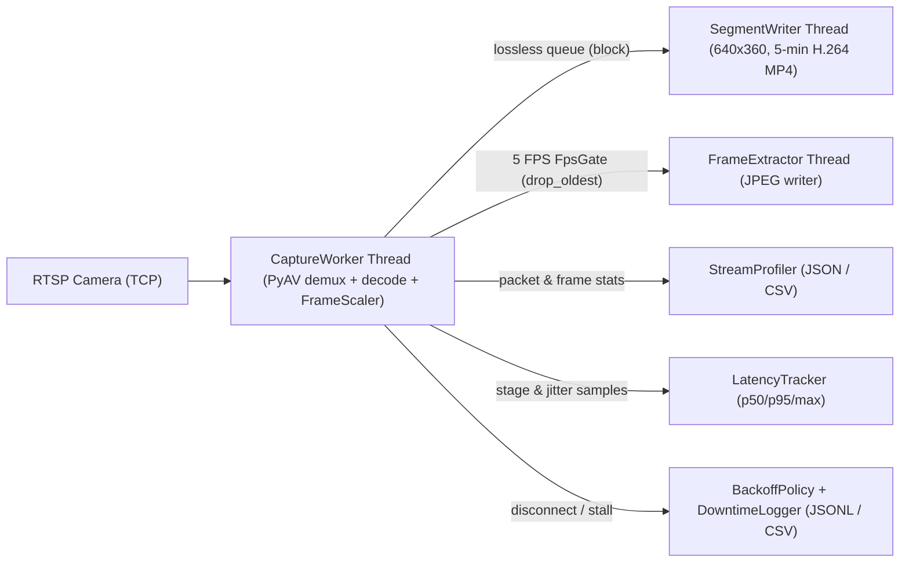

# RTSP Video Ingestion Pipeline

A low-latency, fault-tolerant RTSP-over-TCP ingestion service built with Python, PyAV (FFmpeg), OpenCV, and Pydantic. Designed as the upstream ingestion layer for downstream computer vision pipelines.

## Features

- **Enforced RTSP-over-TCP Transport**: Rejects UDP at config validation, forces `rtsp_transport=tcp` on the FFmpeg demuxer, and verifies the server's `SETUP` `Transport:` response header at connect time.
- **Continuous Rolling 5-Minute Segmented Recording**: Downscales to configurable target resolution (default `640x360`, H.264 `libx264` with `tune=zerolatency`) and rolls over on source media timestamps without dropping frames across segment boundaries. Writes to `.part` files and atomically renames on close.
- **Source-Independent 5 FPS Frame Extraction**: A time-grid `FpsGate` on the source media timeline extracts frames at an effective 5 FPS regardless of whether the camera streams at 15, 25, or 30 FPS. Frames are saved as `[camera_name]_YYYYMMDD_HHMMSS_mmm.jpg`.
- **Input & Output Stream Profiling**: Captures resolution, codec/profile/pixel format, nominal vs. measured source vs. effective capture FPS, average/window/peak bitrate, and keyframe/GOP statistics; probes every closed output clip and exports structured **JSON** and **CSV** reports.
- **Downtime Detection & Exponential Backoff**: Handles network drops, read timeouts (`read_timeout_s`), and silent decoder stalls (`stall_timeout_s`) without crashing. Reconnects with jittered exponential backoff and writes crash-safe (`flush` + `fsync`) logs (`downtime_events.jsonl`, `downtime_outages.csv`, `downtime_summary.json`).
- **End-to-End Latency Quantification**: Measures per-stage monotonic latencies (`arrival -> decode`, `decode -> record`, `decode -> frame_saved`), source-clock delay variation (`source_jitter_ms`), and TCP handshake RTT floor, reporting `p50`, `p90`, `p95`, `p99`, and `max`.

---

## Architecture & Concurrency Design



1. **Single-Producer / Multi-Consumer (`FrameBus`)**:
   - `CaptureWorker` is the sole thread touching the network socket. Each decoded frame is downscaled **once** (`FrameScaler`) and published as an immutable `FramePacket`.
   - **Recorder (`policy="block"`)**: Bounded lossless queue (`queue_size=1500`). The producer never drops a frame destined for the 5-minute video clips.
   - **Extractor (`policy="drop_oldest"`)**: Runs `FpsGate` on the producer side so only frames landing on the `1 / target_fps` grid are queued for JPEG encoding.
2. **Boundary-Lossless Segment Rollover**:
   - Rollover is triggered on source media time (`end_media = start_media + 300s` on a fixed grid).
   - The frame that crosses `end_media` closes the current `.part` container (flushing the encoder) and immediately becomes the **first IDR frame** of the next segment—zero frames are lost or duplicated at boundaries.

---

## How TCP Transport is Enforced

UDP RTP transport suffers from packet loss and macroblocking artifacts over WAN/VPN links. This service enforces TCP in three layers:

1. **Configuration Validation (`core/config.py`)**: `StreamConfig.transport` rejects any value other than `"tcp"` with `TransportError`.
2. **Demuxer Options (`ingestion/rtsp_client.py`)**: `build_ffmpeg_options()` sets `rtsp_transport=tcp`, `fflags=nobuffer`, and `flags=low_delay`, asserted by `assert_tcp_options()`.
3. **Handshake Verification**: During `RtspClient.open()`, FFmpeg debug logs are captured and `parse_negotiated_transport()` inspects the server's `RTSP SETUP` reply header to confirm `RTP/AVP/TCP` was negotiated.

---

## Latency Methodology

Without PTP/GPS hardware sync between the camera and host, absolute one-way clock offset is unknown. We quantify latency using four complementary measurements (`monitoring/latency.py`):

1. **Source-Clock Jitter (`source_jitter_ms`)**: For each frame, $D_i = t_{\text{arrival},i} - \text{pts}_i$. Over a 60-second sliding window (`SourceClock`), $\min(D)$ tracks the fastest-delivered frame (the network floor). $D_i - \min(D)$ measures per-frame queuing/jitter delay above that floor, and $\text{pts}_i + \min(D)$ estimates the drift-free capture wall-clock time.
2. **Pipeline Stage Latencies (Monotonic Clock)**:
   - `arrival_to_decode_ms`: Packet arrival on socket $\rightarrow$ decoded frame ready.
   - `decode_to_record_ms` & `arrival_to_record_ms`: Decoded/arrival $\rightarrow$ encoded & muxed into MP4.
   - `decode_to_frame_saved_ms` & `arrival_to_frame_saved_ms`: Decoded/arrival $\rightarrow$ JPEG flushed to disk.
3. **Source-Referenced End-to-End (`capture_to_frame_saved_ms`)**: Wall time when the JPEG hits disk minus estimated `capture_ts`.
4. **Network Propagation Floor (`connect_rtt_ms`)**: TCP SYN/ACK handshake RTT measured on each connect; `RTT / 2` estimates the one-way propagation floor.

The first `warmup_s` (default `3.0s`) after each (re)connect is excluded from latency percentiles so camera GOP-cache bursts do not skew `p50`/`p95`.

---

## Setup & Execution

### 1. Local Python Setup

```bash
python -m venv .venv
# Windows: .venv\Scripts\activate
# Linux/macOS: source .venv/bin/activate

pip install -r requirements.txt
pip install -e .
```

Configure credentials in `.env` (git-ignored):

```bash
cp .env.example .env
# Edit .env and set RTSP_URL=rtsp://<user>:<password>@<host>:554/Streaming/Channels/1001
```

Run the pipeline:

```bash
# Run continuously (Ctrl+C for graceful shutdown)
rtsp-ingestor run --config config/config.yaml

# Run for 11 minutes (produces 2+ full 5-minute clips)
rtsp-ingestor run --config config/config.yaml --duration 660

# Probe stream metadata & verify TCP transport
rtsp-ingestor probe "$RTSP_URL"
```

### 2. Docker & Local RTSP Simulator (MediaMTX + FFmpeg)

To test locally without a physical camera, `docker-compose.yml` spins up **MediaMTX**, an **FFmpeg** synthetic `testsrc2` publisher (1280x720 @ 25 FPS over TCP), and the **ingestor**:

```bash
docker compose up --build
```

Or run the local disconnect/recovery simulator script directly (requires `ffmpeg` and `mediamtx` in `PATH` or `tools/mediamtx/`):

```bash
python scripts/simulate_disconnect.py --duration 25 --disconnect-at 10 --outage 4
```

### 3. Running Tests

```bash
pip install -r requirements-dev.txt
pytest -v
```

---

## Output & Sample Artifacts Layout

Runtime outputs are written under `output/` (configurable via `output.root_dir`). Committed sample artifacts from a real camera run and a simulated disconnect/recovery test live in `samples/`:

```text
samples/
├── live_camera/
│   ├── segments/<YYYYMMDD>/
│   │   ├── cam01_*_seg0001.mp4          # 5-min 640x360 H.264 clip #1
│   │   ├── cam01_*_seg0002.mp4          # 5-min 640x360 H.264 clip #2
│   │   ├── segments_manifest.csv
│   │   └── segments_manifest.jsonl
│   ├── frames/
│   │   ├── sample_frames/               # Sample 5 FPS JPEGs ([camera]_YYYYMMDD_HHMMSS_mmm.jpg)
│   │   └── frames_index.csv
│   └── reports/
│       ├── stream_profile.json
│       ├── stream_profile.csv
│       ├── latency_summary.json
│       ├── telemetry_timeseries.csv
│       ├── downtime_summary.json
│       └── run_summary.json
└── disconnect_test/
    ├── logs/
    │   ├── downtime_events.jsonl
    │   └── downtime_outages.csv
    └── reports/
        ├── downtime_summary.json
        ├── latency_summary.json
        └── stream_profile.json
```
